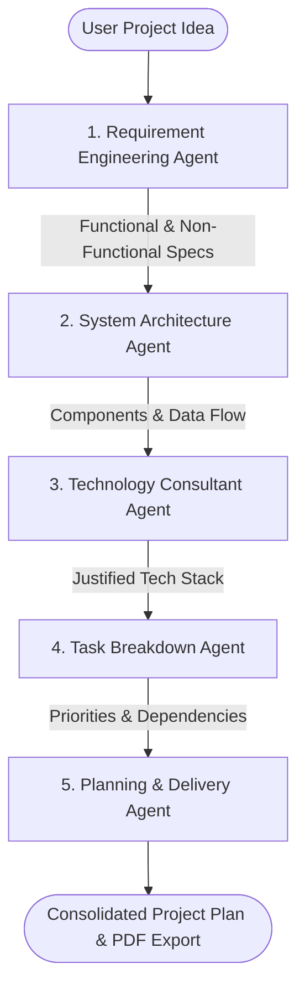

# 🚀 AI-Powered Project Planning Assistant (AIP)

[](https://fastapi.tiangolo.com)
[](https://github.com/langchain-ai/langgraph)
[](https://react.dev)
[](https://vitejs.dev)
[](https://ollama.ai)
[](LICENSE)

An intelligent, full-stack multi-agent system designed to transform raw software project concepts into production-grade engineering plans. Built with **FastAPI**, **LangGraph**, **React**, and **Ollama** (`qwen2.5:7b`), AIP orchestrates 5 specialized AI agents to generate comprehensive requirements, architecture blueprints, justified technology stacks, prioritized task breakdowns, and execution roadmaps.

---

## 📑 Table of Contents

- [Key Features](#-key-features)
- [Agentic Workflow Architecture](#-agentic-workflow-architecture)
- [Tech Stack](#-tech-stack)
- [Security & API Key Management](#-security--api-key-management)
- [Prerequisites](#-prerequisites)
- [Quick Start Guide](#-quick-start-guide)
  - [1. Clone Repository](#1-clone-repository)
  - [2. Backend Setup](#2-backend-setup)
  - [3. Frontend Setup](#3-frontend-setup)
  - [4. Set Up Local LLM (Ollama)](#4-set-up-local-llm-ollama)
- [Running the Application](#-running-the-application)
- [Project Structure](#-project-structure)
- [API Endpoints](#-api-endpoints)
- [Exporting Reports](#-exporting-reports)
- [Contributing](#-contributing)
- [License](#-license)

---

## ✨ Key Features

- **5-Agent Autonomous Pipeline**: Orchestrates 5 specialized LangGraph agents sequentially to build a cohesive, enterprise-ready project plan.
- **Real-Time Streaming (SSE)**: Employs Server-Sent Events (`/api/generate-plan-stream`) to stream agent thoughts, active status, and deliverables to the frontend in real time.
- **Interactive Architecture & Roadmap Visualizer**: Dynamic visual representation of system components, data flow pipelines, and milestone schedules.
- **Dependency-Aware Task Breakdown**: Breaks down projects into actionable tasks with explicit dependencies (`T1` -> `T2`), priorities, and implementation phases.
- **Professional PDF Export**: Generates beautifully formatted, branded PDF project specification documents using a custom ReportLab engine.
- **Local-First & Privacy Preserving**: Runs completely locally via **Ollama** (`qwen2.5:7b`) with zero cloud telemetry or data leakage.
- **Fault-Tolerant Dynamic Fallback**: Features an intelligent fallback heuristic engine that guarantees structured outputs even if the local model is offline.
- **Persistent Plan Archive**: Stores generated project plans in a local SQLite database for instantaneous search, reloading, and review.

---

## 🧠 Agentic Workflow Architecture

The LangGraph orchestration coordinates 5 specialized agents that feed contextual state forward across the planning lifecycle:



| Agent | Role | Deliverables |
| :--- | :--- | :--- |
| **1. Requirement Engineering** | Business Analyst & Product Manager | Target users, functional/non-functional requirements, constraints |
| **2. System Architecture** | Principal Solutions Architect | Architectural style, system components, responsibilities, data flow |
| **3. Technology Consultant** | Lead Tech Architect | Justified frontend, backend, database, AI/ML tools tailored to the idea |
| **4. Task Breakdown** | Scrum Master & Engineering Lead | Phased tasks, priority levels (`High`/`Medium`/`Low`), dependency tracking |
| **5. Planning & Delivery** | Technical Project Manager | Delivery roadmap, weekly milestones, risk analysis & mitigation strategies |

---

## 🛠 Tech Stack

### **Backend**
- **Framework**: [FastAPI](https://fastapi.tiangolo.com/) (Asynchronous REST API & SSE streaming)
- **Agent Orchestration**: [LangGraph](https://github.com/langchain-ai/langgraph) & [LangChain](https://www.langchain.com/)
- **LLM Engine**: [Ollama](https://ollama.ai/) running `qwen2.5:7b`
- **Database**: SQLite (SQLAlchemy / Python standard library)
- **Document Generation**: [ReportLab](https://www.reportlab.com/) PDF Engine
- **Server**: Uvicorn ASGI

### **Frontend**
- **Framework**: [React 18](https://react.dev/) + [Vite](https://vitejs.dev/)
- **Styling**: Vanilla CSS & modern design tokens (Glassmorphism, Dark/Light modes)
- **Icons**: [Lucide React](https://lucide.dev/)
- **Data Fetching**: Native Fetch API with EventSource streaming

---

## 🔐 Security & API Key Management

This project strictly adheres to security best practices to protect sensitive credentials:

1. **Local-First Privacy**: By default, AIP uses Ollama for local LLM inference. No project ideas or proprietary code ever leave your machine.
2. **Hidden Keys & Ignored Environment Files**:
   - `.env` files are explicitly listed in `.gitignore` at both the root and `backend/` levels.
   - Sensitive database instances (`*.db`, `project_plans.db`) and runtime logs are never tracked or committed to version control.
3. **Environment Template**: Use `.env.example` to declare configuration variables safely without committing real secrets.
4. **Client-Side Keys**: Optional user-provided keys are strictly stored in browser `localStorage` or session memory and transmitted over secure headers/queries directly to your local instance.

---

## 📋 Prerequisites

Before running the project, ensure you have the following installed on your machine:
- **Python**: `3.10` or higher
- **Node.js**: `18.x` or higher (and `npm`)
- **Ollama**: Download and install from [ollama.ai](https://ollama.ai/)
- **Git**: Installed and configured

---

## 🚀 Quick Start Guide

### 1. Clone Repository

```bash
git clone https://github.com/<your-username>/<your-repo-name>.git
cd <your-repo-name>
```

---

### 2. Backend Setup

1. Open a terminal and navigate to the `backend` folder:
   ```bash
   cd backend
   ```

2. Create and activate a Python virtual environment:
   ```bash
   # Windows (PowerShell)
   python -m venv venv
   .\venv\Scripts\Activate.ps1

   # macOS / Linux
   python3 -m venv venv
   source venv/bin/activate
   ```

3. Install required Python packages:
   ```bash
   pip install -r requirements.txt
   ```

4. Configure environment variables:
   ```bash
   # Copy the example file to .env
   cp .env.example .env
   ```
   *(Ensure `.env` contains your preferred Ollama model name and host address)*

---

### 3. Frontend Setup

1. Open a new terminal and navigate to the `frontend` folder:
   ```bash
   cd frontend
   ```

2. Install dependencies:
   ```bash
   npm install
   ```

---

### 4. Set Up Local LLM (Ollama)

1. Make sure the Ollama desktop service is running.
2. Pull the default `qwen2.5:7b` model:
   ```bash
   ollama pull qwen2.5:7b
   ```
   *(Note: If Ollama is not installed or offline, the backend's intelligent dynamic fallback engine will automatically activate).*

---

## 💻 Running the Application

### Start the Backend Server

From the `backend` folder (with virtual environment activated):
```bash
python -m uvicorn backend.main:app --host 127.0.0.1 --port 8000 --reload
```
The FastAPI server will start at `http://127.0.0.1:8000`. You can test the API interactive documentation at:
- Swagger UI: `http://127.0.0.1:8000/docs`
- ReDoc: `http://127.0.0.1:8000/redoc`

### Start the Frontend Client

From the `frontend` directory:
```bash
npm run dev
```
Open your browser and navigate to the URL shown in the terminal (typically `http://localhost:5173`).

---

## 📁 Project Structure

```
.
├── .gitignore                  # Global gitignore preventing secret/env leaks
├── README.md                   # Comprehensive project documentation
├── backend/
│   ├── .env.example            # Environment variables template
│   ├── .gitignore              # Backend-specific gitignore
│   ├── config.py               # Centralized configuration settings
│   ├── main.py                 # FastAPI application routes & SSE endpoints
│   ├── requirements.txt        # Python dependencies
│   ├── agents/                 # Multi-Agent LangGraph implementations
│   │   ├── requirement_agent.py
│   │   ├── architecture_agent.py
│   │   ├── technology_agent.py
│   │   ├── task_agent.py
│   │   └── planning_agent.py
│   ├── models/                 # Pydantic schemas & state models
│   │   └── schemas.py
│   ├── services/               # Database, LLM, and PDF generation services
│   │   ├── db_service.py
│   │   ├── llm_service.py
│   │   └── pdf_service.py
│   └── workflow/               # LangGraph compiled state graph
│       └── graph.py
└── frontend/
    ├── package.json            # Node.js dependencies & scripts
    ├── vite.config.js          # Vite configuration
    ├── index.html              # Entry HTML
    └── src/
        ├── App.jsx             # Main interactive application
        ├── index.css           # Global typography & design tokens
        └── components/         # Modular UI components
            ├── ApiKeyModal.jsx
            ├── ArchitectureView.jsx
            ├── HistorySidebar.jsx
            ├── ProcessingScreen.jsx
            ├── RoadmapView.jsx
            └── TaskListView.jsx
```

---

## 📡 API Endpoints

| Method | Endpoint | Description |
| :--- | :--- | :--- |
| `GET` | `/api/health` | Health check endpoint |
| `POST` | `/api/generate-plan` | Synchronously runs the 5-agent LangGraph workflow |
| `GET` | `/api/generate-plan-stream` | Server-Sent Events (SSE) live streaming for plan generation |
| `GET` | `/api/plans` | Fetches historical project plans from SQLite |
| `GET` | `/api/plans/{plan_id}` | Retrieves a single plan by its ID |
| `GET` | `/api/export-pdf/{plan_id}` | Generates and downloads a formatted PDF document |

---

## 📄 Exporting Reports

When a plan generation completes, click **Export to PDF** on the dashboard. AIP dynamically compiles:
- Project executive summary and objective
- Formatted requirements checklist
- System architecture components and data flow
- Technology stack justification matrix
- Work breakdown structure (WBS) with dependencies
- Weekly milestones & risk mitigations

---

## 🤝 Contributing

Contributions, issues, and feature requests are welcome!

1. Fork the Project
2. Create your Feature Branch (`git checkout -b feature/AmazingFeature`)
3. Commit your Changes (`git commit -m 'Add some AmazingFeature'`)
4. Push to the Branch (`git push origin feature/AmazingFeature`)
5. Open a Pull Request

---

## 📄 License

Distributed under the MIT License. See `LICENSE` for more information.
